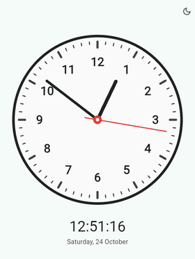

# Flutter Analog Clock

A smooth, minimal analog clock built with Flutter. No external packages.

[**Live
demo**](https://sharmadhiraj.github.io/Flutter-Analog-Clock/) · [Source](https://github.com/sharmadhiraj/Flutter-Analog-Clock)



## Features

- Smooth sweeping second hand, rendered with `CustomPaint`
- Light and dark themes with a one tap toggle
- Digital time and date readout
- Responsive on mobile, tablet and web

## Run

```sh
flutter run
```

Runs on Android, iOS and web.

## Structure

```
lib/
  app.dart          App and theme mode
  screens/          Clock screen
  widgets/          Analog clock, digital readout, theme toggle
  painters/         Face and hands painters
  theme/            Light and dark palettes
  utils/            Ticker, time angles, formatting
```

## License

[MIT](LICENSE)
